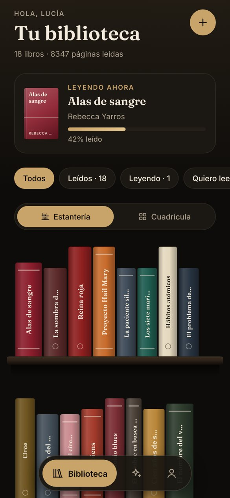
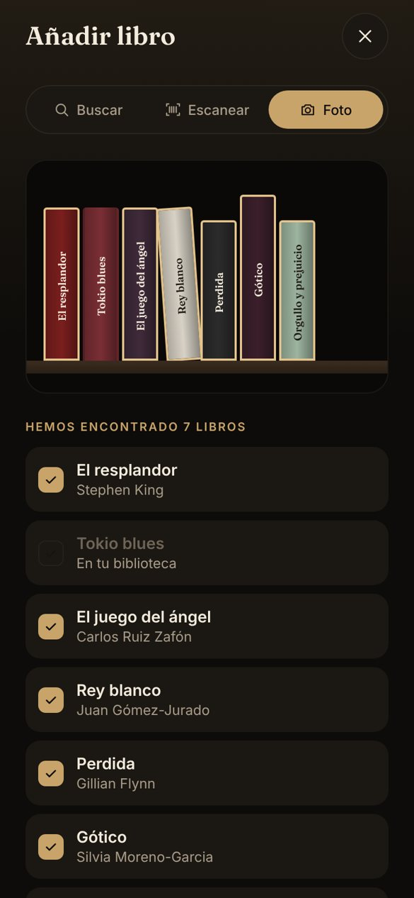
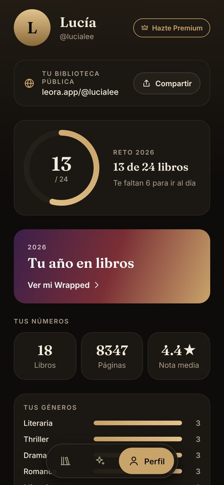
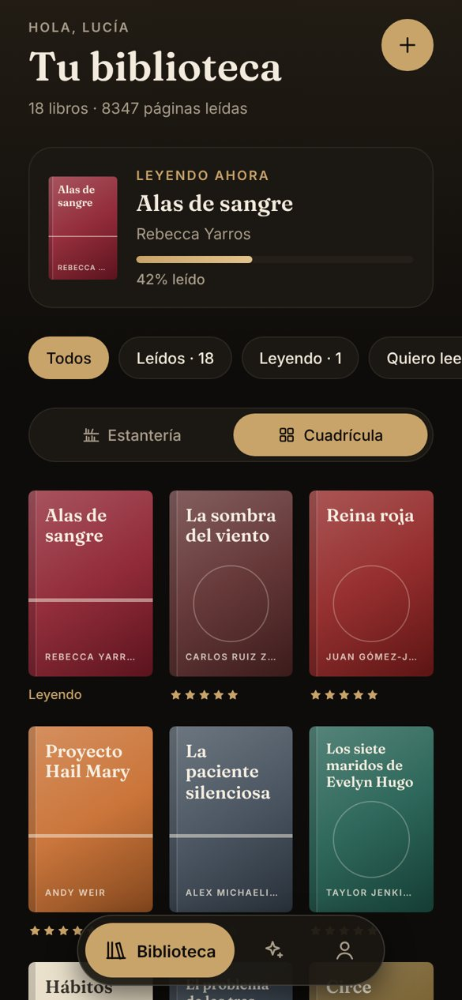
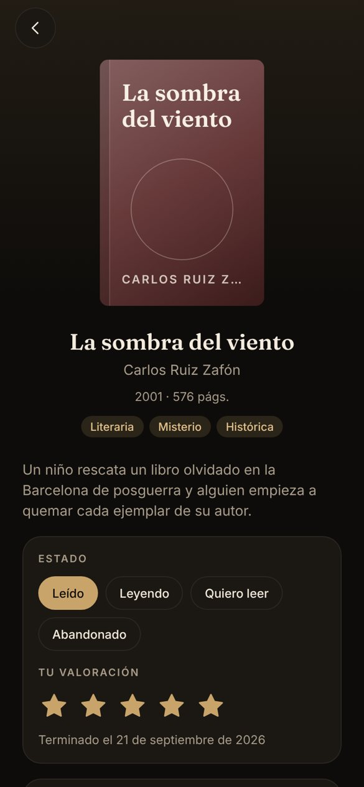
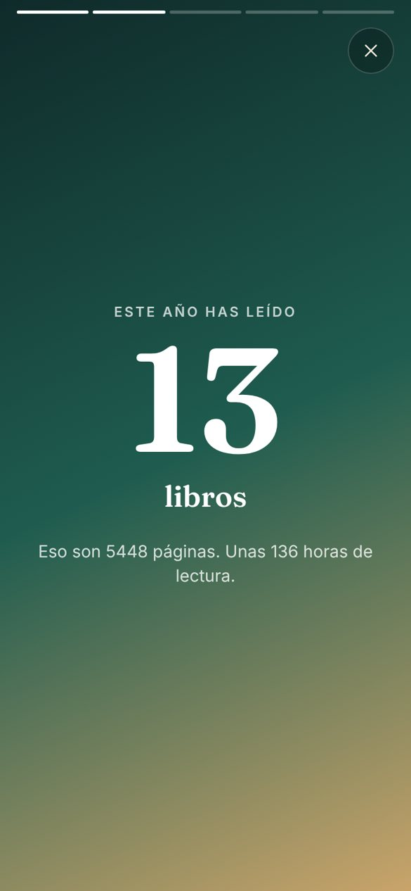
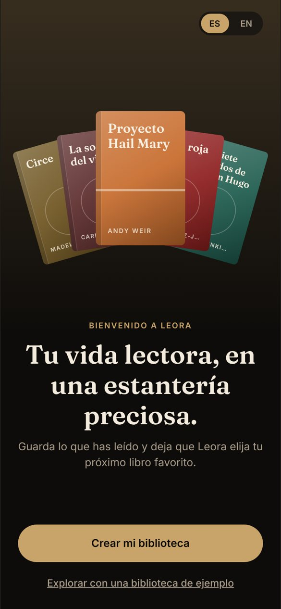
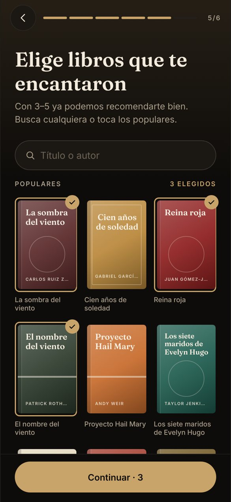

<div align="center">

# 📚 Leora

**Your reading life, beautifully shelved — and your next favourite book, picked by AI.**

Leora is a mobile app for readers who want a gorgeous personal library of everything they've read, and smart, explainable recommendations for what to read next.

[](https://expo.dev)
[](https://reactnative.dev)
[](https://www.typescriptlang.org)
[](https://supabase.com)
[](https://github.com/rnachoc/leora/actions/workflows/ci.yml)


🇬🇧 English · 🇪🇸 Español

**[▶ Try the live demo](https://rnachoc.github.io/leora/app/)** · [Landing page](https://rnachoc.github.io/leora/)

</div>

---

<p align="center">
  
  
  
  
</p>

<details>
<summary>More screens</summary>
<p align="center">
  
  
  
</p>
<p align="center">
  
  
  
</p>
</details>

## ✨ What it does

| | Feature | Description |
|---|---|---|
| 👋 | **Guided onboarding** | A 6-step welcome questionnaire (pace, genres, moods, favourite books, goal) and a quick app guide, so recommendations work from minute one. |
| 📖 | **Personal library** | Every book you've read, on a realistic bookshelf or a cover grid — switch with one tap. |
| 📷 | **Add books in seconds** | Search by title/author, scan the ISBN barcode, or snap a photo of your shelf and let AI recognise the spines. |
| ⭐ | **Rate & remember** | Star ratings, a short review, read date and status: *read, reading, want to read, did not finish*. |
| 🔮 | **AI recommendations** | Pick a genre, a mood ("something light", "break my heart") or "like this book" — get 3 picks, each with *why* it fits your taste. |
| 🛒 | **Buy in one tap** | Links to Amazon, Casa del Libro, Fnac/Kobo and audiobook platforms. |
| 🏆 | **Goals & Wrapped** | Yearly reading goal, achievement badges and a shareable year-in-review. |
| 🌐 | **Public profile** | Share your library with a link. |

## 🧭 Project structure

```
leora/
├── app/        # Mobile app — Expo (React Native) + TypeScript + expo-router
├── landing/    # Marketing landing page with waitlist
├── docs/       # Product spec, architecture and roadmap
└── .github/    # CI workflows and issue/PR templates
```

## 🚀 Getting started

```bash
cd app
npm install
npm run start        # Expo dev server — scan the QR with Expo Go (iOS/Android)
npm run web          # Run in the browser
npm run typecheck    # TypeScript strict check
```

> Or just open the **[live web demo](https://rnachoc.github.io/leora/app/)** — it's deployed to GitHub Pages on every push to `main`.
>
> The current version is an **interactive prototype**: catalog search and covers are real (Open Library) and your library is saved on the device; it starts from a sample library. Backend (Supabase), auth and the AI recommendation engine are next on the [roadmap](docs/ROADMAP.md).

## 🏗️ Tech stack

| Layer | Choice | Why |
|---|---|---|
| Mobile | Expo + React Native + TypeScript | One codebase for iOS, Android and web |
| Navigation | expo-router | File-based routing, deep links for public profiles |
| Backend | Supabase (Postgres, Auth, Storage, Edge Functions) | Fast MVP, row-level security, generous free tier |
| Auth | Email · Google · Sign in with Apple | Apple sign-in is mandatory on iOS when offering Google |
| Catalog | Open Library (live) · Google Books optional | Real books and covers — the AI never invents titles or links |
| AI | LLM ranking over real catalog candidates | Explainable picks grounded in the user's library |
| Monetization | Freemium (RevenueCat) + affiliate links | 3 free recommendations/month, Premium unlimited |

More detail in [docs/ARCHITECTURE.md](docs/ARCHITECTURE.md).

## 📍 Roadmap

- [x] Product definition
- [x] Interactive prototype
- [x] Waitlist landing page
- [ ] Paid traffic validation
- [x] Real catalog search and covers
- [x] Onboarding questionnaire and app guide
- [ ] Supabase backend and auth
- [ ] Barcode scanner & shelf-photo recognition
- [ ] AI recommendation engine
- [ ] Premium subscription & affiliate links
- [ ] App Store / Google Play launch
- [ ] Social layer: friends, verified author profiles and posts

Full plan in [docs/ROADMAP.md](docs/ROADMAP.md).

## 📄 License

© 2026 Leora. All rights reserved. The source is public for transparency and portfolio purposes; it is not licensed for reuse.
